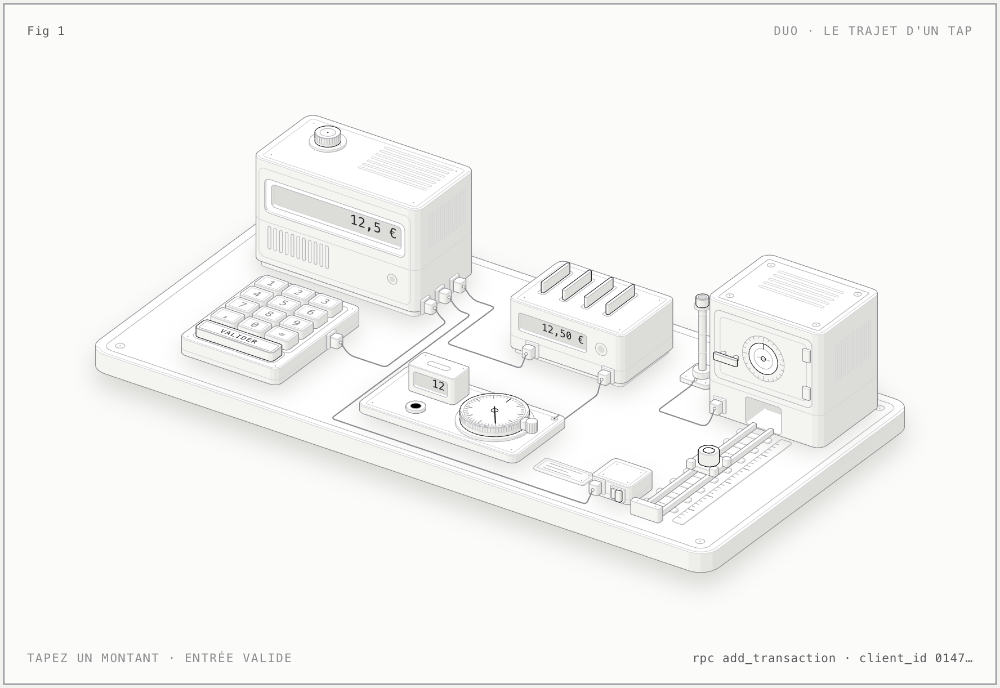

## Un écran, trois taps

Je développe Duo, une application mobile pour tenir un budget à deux. L'écran qui compte le plus est le plus petit : la saisie rapide. Un montant sur un pavé numérique, une catégorie déjà présélectionnée, « Valider ». Si cet écran paraît lent une seule fois, on arrête de noter ses dépenses, et l'app ne sert plus à rien.

Derrière ces trois taps, il y a sept étapes, deux threads, un cache et un serveur. Pour les voir, j'ai démonté l'écran en machine d'atelier : un clavier sur ressorts, un boîtier qui garde le brouillon, un cache, un rail jusqu'à un coffre.



La figure est interactive : on tape un montant, on valide, on coupe le réseau, et on regarde ce qui bouge. **[Ouvrir la figure interactive](/figures/duo-tap.html)**

Les durées y sont étirées pour être suivies à l'œil. Seul le ressort des touches tourne à sa vraie vitesse.

L'app est en cours de développement, pas encore sur les stores. Ce qui suit décrit le code tel qu'il est écrit aujourd'hui.

## 1. Le doigt se pose : rien ne passe par React

Une touche du pavé doit réagir avant même que l'app sache ce qu'elle va faire du chiffre. Si ce retour visuel attend un rendu React, il attend aussi tout ce que le thread JavaScript est en train de faire à ce moment-là.

Le composant écrit donc dans une valeur partagée de Reanimated, et c'est tout :

```tsx
const scale = useSharedValue(1);
const springStyle = useAnimatedStyle(() => ({ transform: [{ scale: scale.get() }] }));

<AnimatedPressable
  onPressIn={() => {
    if (!reduceMotion) scale.set(spring(pressedScale, 'snappy'));
  }}
  onPressOut={() => scale.set(reduceMotion ? 1 : spring(1, 'snappy'))}
  style={[style, springStyle]}
/>
```

Le ressort (raideur 420, amortissement 24) est calculé sur le thread UI. Aucun `setState`, aucun rendu : la touche descend à 0,95 même si le thread JS est occupé.

J'ai choisi un ressort plutôt qu'une transition à durée fixe pour une raison précise : sur un pavé numérique, on tape vite. Un ressort s'interrompt proprement quand le doigt revient avant la fin du mouvement, alors qu'une transition de 100 ms doit soit finir, soit sauter.

Le bouton « Valider », lui, garde la transition de 100 ms. On ne le tape pas en rafale, et deux états suffisent.

## 2. Le doigt se lève : l'événement arrive dans JavaScript

`onPress` ne part que si le doigt se relève sur la touche. C'est là que le thread JS entre en jeu :

```tsx
onPress={() => {
  Haptics.selectionAsync();
  onKey(key);
}}
```

Deux appels, dans cet ordre : le retour haptique, un appel natif, puis `onKey`, qui met à jour le brouillon.

## 3. Le brouillon est une chaîne, le montant est un entier

Le brouillon n'est pas un nombre. C'est la chaîne que l'utilisateur a tapée, avec un point comme séparateur quelle que soit la langue :

```ts
export function applyAmountKey(draft: string, key: AmountKey, fractionDigits: number): string {
  if (key === 'delete') return draft.slice(0, -1);
  // …
  if (decimals !== undefined && decimals.length >= fractionDigits) return draft;
  if (digitCount >= MAX_DIGITS) return draft;
  return draft + key;
}

/** « 12.5 » en EUR → 1250n ; « 12500 » en XOF → 12500n. */
export function draftToMinor(draft: string, fractionDigits: number): bigint {
  const [integer, decimals = ''] = draft.split('.');
  const minor = (integer || '0') + decimals.padEnd(fractionDigits, '0').slice(0, fractionDigits);
  return BigInt(minor);
}
```

Trois choses sont séparées : ce qui est tapé (`"12.5"`), ce qui est affiché (`12,5 €` en français), et ce qui est envoyé (`1250n`, en centimes). L'argent ne passe jamais par un flottant, ni à l'écran, ni sur le réseau, ni en base.

Le nombre de décimales vient de la devise. Le franc CFA n'en a pas : la touche virgule devient alors une touche « 000 ».

## 4. Valider : le cache change avant le serveur

Quand on valide, l'app n'attend pas la réponse. `onMutate` modifie le cache TanStack Query tout de suite :

```ts
export function useAddTransaction() {
  const queryClient = useQueryClient();
  const optimistic = useOptimisticCheckIn();
  return useMutation({
    // Le même `clientId` à chaque renvoi : le serveur garde une seule ligne.
    mutationFn: (input: NewTransaction) => backend.addTransaction(input),
    onMutate: (input) => optimistic('logged', input),
    onError: (_error, _input, context) => {
      if (context?.previous) queryClient.setQueryData(context.key, context.previous);
    },
    onSuccess: ({ reward }) => rewardNotice.set(reward),
    onSettled: () => {
      queryClient.invalidateQueries({ queryKey: gameKeys.all });
      queryClient.invalidateQueries({ queryKey: celebrationKeys.pending });
      queryClient.invalidateQueries({ queryKey: categoryKeys.all });
      queryClient.invalidateQueries({ queryKey: accountKeys.me });
    },
  });
}
```

Le total du mois augmente et « j'ai saisi aujourd'hui » passe à vrai, pendant que la requête est encore en route. Dans la figure, c'est le voyant du panneau d'accueil qui s'allume avant que le chariot ait atteint le coffre.

Ce que ça coûte : il faut savoir revenir en arrière. `onMutate` rend l'état d'avant, et `onError` le remet en place. Un détail compte ici : la clé du cache est figée au moment de l'envoi. Si l'utilisateur change de foyer pendant que la requête est en vol, l'annulation doit retomber dans le cache du foyer d'origine, pas dans celui qu'il regarde maintenant.

## 5. Le réseau : un identifiant généré sur l'appareil

Sur mobile, une requête peut échouer après avoir réussi : le serveur a écrit la ligne, mais la réponse s'est perdue dans un tunnel. Si l'app renvoie sans précaution, la dépense est comptée deux fois.

Chaque saisie reçoit donc un identifiant dès l'ouverture de l'écran, avant tout appel réseau :

```ts
const [freshClientId] = useState(() => randomUUID());
```

Cet identifiant est unique en base. Un renvoi avec le même `client_id` ne crée rien : le serveur retrouve la ligne et la renvoie.

Le brouillon gardé après un échec conserve son identifiant, à une condition : que rien n'ait changé. Dès que l'utilisateur modifie le montant ou la catégorie, c'est une autre dépense, donc un autre identifiant.

Dans la figure, coupez le réseau avant de valider : le chariot bute sur la barrière, revient, et le cache reprend sa valeur d'avant. Le montant, lui, reste affiché.

## 6. Le serveur décide du jeu

Duo est un jeu coopératif : une série partagée, de l'expérience, des quêtes. Rien de tout ça n'est calculé par l'app. Le client envoie une dépense, et le serveur répond avec une récompense, ou sans :

```ts
export type Reward = {
  /** XP du pointage lui-même (journée complétée ensemble, « rien dépensé »). */
  xp: number;
  /** La journée vient d'être complétée par tous : nouvelle longueur de la série. */
  streakDays: number | null;
  /** XP des quêtes hebdomadaires terminées par ce pointage. */
  questXp: number;
};
```

Deux raisons à ce choix. La première est évidente : un client qui calcule ses propres points peut tricher. La seconde l'est moins : la série dépend de ce que l'autre personne du foyer a fait aujourd'hui, et le téléphone ne le sait pas de façon fiable.

Une deuxième dépense le même jour renvoie `null`. C'est voulu : le jeu récompense la régularité, pas le nombre de saisies, et encore moins le montant.

## 7. Le retour : la récompense attend le bon écran

La saisie se fait dans une feuille qui recouvre l'accueil. Or c'est l'accueil qui doit réagir : le compteur de série, la mascotte, le message. Si la récompense s'affichait à la réception de la réponse, elle se jouerait derrière la feuille, sans que personne la voie.

`onSuccess` la dépose donc dans une boîte, et l'accueil la prend quand il redevient visible :

```ts
let pending: { reward: Reward | null; at: number } | null = null;

export const rewardNotice = {
  set: (reward: Reward | null) => {
    pending = { reward, at: Date.now() };
  },
  take: () => {
    const value = pending;
    pending = null;
    return value;
  },
};
```

`take` vide la boîte : la récompense est jouée une fois, même si l'écran reprend le focus plusieurs fois.

Enfin `onSettled` invalide quatre clés du cache (le jeu, les célébrations, les catégories, le compte), que la requête ait réussi ou non. L'état optimiste n'était qu'une estimation : c'est la réponse du serveur qui fait foi.

## Ce que ce découpage coûte

- **Deux sources de vérité à l'écran pendant un instant.** Entre `onMutate` et la réponse, l'app affiche ce qu'elle espère. Il faut accepter qu'elle puisse se tromper, et écrire le chemin de retour avec autant de soin que le chemin nominal.
- **Des animations qui s'écrivent autrement.** Une valeur partagée ne se lit pas comme un état React. Tout ce qui tourne sur le thread UI doit rester petit et ne rien capturer de lourd.
- **Un serveur qui en fait plus.** Calculer le jeu côté serveur veut dire des fonctions SQL à tester et à faire évoluer, au lieu de quelques lignes de TypeScript dans l'app.

## Ce qu'il faut retenir

Un tap traverse quatre frontières : du thread UI au thread JS, de l'état local au cache, du cache au réseau, du client au serveur. À chacune, la même question revient : qui a le droit de répondre tout de suite, et qui doit attendre ?

Le ressort répond tout de suite, parce qu'il ne décide de rien. Le cache répond tout de suite, parce qu'il sait revenir en arrière. Le serveur prend son temps, parce que lui seul sait ce que vaut la journée.
